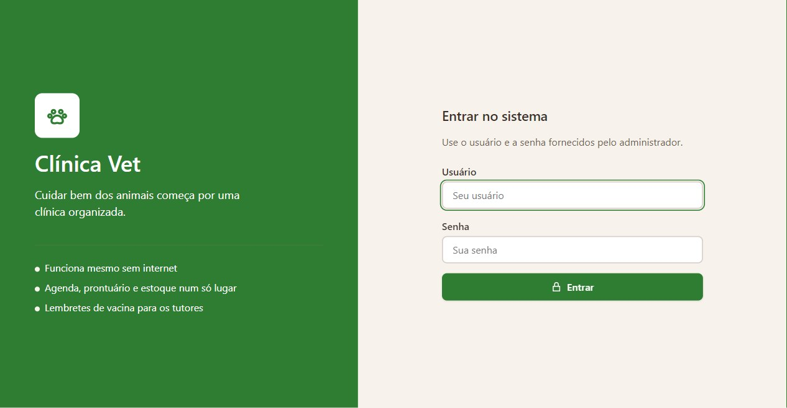
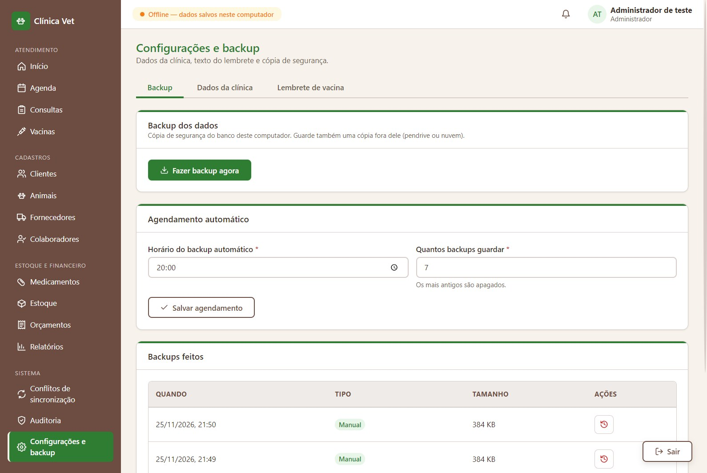

# Manual rápido da Clínica Vet

As imagens mostram um ambiente de demonstração. Para instalar ou preparar um computador novo, use o [guia de instalação e sincronização](SINCRONIZACAO.md).

## Entrar no aplicativo

1. Abra **Clínica Veterinária**.
2. Informe o usuário e a senha que o administrador entregou a você e selecione **Entrar**.
3. Confira seu nome e perfil no topo. Ao terminar, selecione **Sair**.

Nos demais computadores novos, use a conta depois que ela chegar pela primeira sincronização. A partir daí, você pode entrar mesmo sem internet. O perfil **Administrador** tem acesso a **Colaboradores**, **Auditoria**, **Conflitos de sincronização** e **Configurações e backup**. Os perfis **Veterinário(a)** e **Atendente** veem o menu correspondente à função.

## Trabalhar sem internet

O aviso **Offline — dados salvos neste computador** significa que o trabalho permanece no computador em uso. Com o MySQL configurado, o aplicativo tenta enviar e receber as alterações quando a internet volta. Confira o indicador no topo.

## Administrar contas e alterações

- Em **Colaboradores**, use **Novo colaborador** para criar o usuário e escolher o perfil. Para trocar a senha, use **Redefinir senha** na linha do cadastro.
- Em **Auditoria**, selecione o período e filtre pela ação para consultar quem fez uma alteração e quando.
- Em **Conflitos de sincronização**, leia os dados local e central antes de escolher a versão. Se o aviso indicar CPF ou login duplicado, corrija o cadastro em **Colaboradores** antes de reenviar.

## Fazer uma cópia de segurança

1. Entre com o perfil **Administrador** e abra **Configurações e backup → Backup**.
2. Selecione **Fazer backup agora**. Confira a nova linha do tipo **Manual** em **Backups feitos**.
3. Para agendar, informe o horário de São Paulo e quantas cópias guardar. Selecione **Salvar agendamento**. O aplicativo faz a cópia a partir desse horário enquanto estiver aberto.

Para restaurar, identifique a cópia pela data e pelo horário, clique em **Restaurar este backup** e confira a confirmação. O aplicativo guarda uma cópia preventiva, restaura o banco deste computador e volta à tela de login.

## Conferir em dois computadores de teste

1. Configure ambos no mesmo MySQL de teste. Use o primeiro computador para cadastrar os usuários dos três perfis e confirme que eles conseguem entrar no segundo após a sincronização.
2. Desconecte o primeiro computador da rede. Entre com os três perfis. Como **Administrador**, crie um backup e altere o nome da clínica em **Configurações e backup → Dados da clínica**.
3. Reconecte o primeiro computador. Confira **Envios em dia** e verifique no segundo computador se o novo nome apareceu. Registre os computadores, os perfis testados e o resultado para o aceite do grupo.
